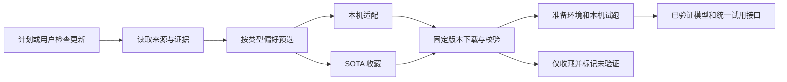

# 末日种子 · 开发文档

方案 v0.4 · 2026 年 11 月 11 日 · 首发 Windows 11 x64

末日种子在联网时查找和保存模型，断网时使用已经在本机验证过的版本。前端只保留「首页」「模型库」「试用」和「配置」：首页只有背景、说明和两个入口；模型库按「待探索」「待下载」「已落库」三段排列；试用直接展示当前可用的本地功能；配置集中模型服务连接、更新时间、手动更新、模型保存位置和每类下载偏好。每页只呈现当前任务需要的操作与状态。硬件探测、依赖准备、模型文件校验和试跑由后台负责。

## 1. 模型库与试用


模型库从雪原种子库进入。网页使用本地 `src/doomsday_seed/web/assets/vault.webp`，以玄武岩和苔绿为基调。主要操作和导航点击后出现渐渐散去的绿痕。支持键盘焦点与减少动态效果。页面、字体、脚本和图像均能从本机加载。

- 首页只保留背景、说明文字、「进入模型库」和「试用本地模型」两个入口。
- 模型库不设页面标题，按「待探索」「待下载」「已落库」三个类别纵向间隔排列。每张卡片直接展示类型、版本名、来源、大小、状态、公开说明和下一步；说明来自公开元数据，不需要先下载。
- 版本卡片显示版本名、来源、大小、状态和下一步。状态按实际结果显示排队、下载、校验、准备环境、本机验证、离线可用、已收藏、等待资源或暂未接入。
- 试用区左侧按大类选择类型，控制台按类型适配：对话类型输入消息并流式回答，姿态与手部类型上传本地图片识别。模型列表只包含该类型已验证的本地版本；模型库版本卡片上的「试用」携带具体版本 ID，也可以直接打开试用区挑选。
- 配置页集中模型服务 API Key、调用链接与模型名称，每日自动更新时间与「立即更新」，模型保存路径，以及每个类型的下载偏好。每个类型默认勾选「平衡」，并单独提供「SOTA」收藏勾选。
- 环境管理、端口和调参不出现在普通页面。运维诊断、校验和恢复工具继续由 CLI 或本机管理 API 提供。

## 2. 浏览模式和每类下载偏好

模型库不再区分「本机适配」和「SOTA 收藏」两种浏览模式：全部候选在同一个列表中等同展示，只是下载结果按下面的方式处理。

| 收录方式 | 适用版本 | 下载结果 |
| --- | --- | --- |
| 本机适配 | 具有本机适配器的候选与已验证版本 | 自动准备依赖，下载固定版本，校验并在本机试跑。通过后才能进入试用列表。 |
| 收藏归档 | 有可比公开成绩的领先版本，包括不适合本机的模型 | 按清单收藏权重和配套文档。无需本机 GPU 或推理运行器。显示「已收藏 · 未验证」，之后支持的版本可以复用本地文件准备试用。 |

「SOTA」指已覆盖来源内的公开领先结果。证据需要绑定到具体版本与变体，并明确数据集修订、切分、协议和指标。来源、协议、计分方向和单位一致的成绩才能排名。公开自报结果带来源。只有一条可比记录时显示记录数量，未找到证据时显示空状态。原精度成绩不能自动计入量化变体。下载数和发布时间只作发现线索。

每个类型单独保存速度优先、平衡、精度优先三个可多选的本机档位。每个类型默认勾选「平衡」；「SOTA」作为同一行的独立勾选，收藏公开领先版本时不要求本机适配。领先版本与普通候选同等展示，也可以直接点版本卡片上的「收藏 SOTA」。多档位时，一轮每档最多试装一个新变体，重合文件按固定版本复用。SOTA 自动收藏每类每轮最多一个未收藏的公开领先版本。已有验证版本和历史包保留。许可缺失、受限或文件清单不可验证时跳过自动下载。

速度和质量以同任务、同配置的实测结果比较。文本记录首 token、端到端时间、生成速度和固定样例通过率。速度档先过质量门槛再比较耗时，精度档在稳定性和等待时间门槛内比较质量，平衡档沿用 60% 质量加 40% 速度的规则。动作模型当前提供固定的官方版本，空图测试只验证可运行性，暂不产出质量排名。

本地规则在没有足够实测数据时，只以估算内存占用从小到大选择速度、平衡、精度档的待测候选；参数量或体积较大并不能证明精度更高，较小也不能保证一定更快。接入 Agent 的模型服务后，它可以在已通过格式、许可和资源筛选的候选中结合硬件摘要与已有评测给出建议，下载后的固定样例评测才决定本机结果。不能比较或尚无实测时不宣称质量排名。

## 3. 后台工作流



1. **发现。** Hugging Face 读取结构化模型卡和固定文件清单。MediaPipe 人体姿态和手部关节采用登记的官方权重。源失败时保留已有目录。发布者列表与仓库元数据读取各最多 5 路并发；单个仓库失败只标记本轮 partial，不丢弃其他结果。配置页的「立即更新」和每日计划都按类型偏好读取来源并运行下载流程。服务运行期间按日更新，已有 Windows 计划可继续调用同一 CLI。
2. **预选。** 本机模式采样可用 RAM、显存、后端与驱动，扣除预留后筛选。内置规则 Agent 处理常规预选。可配置外部 Agent 读取证据、预算与有限诊断，给出下载建议和受控调参建议。脚本负责校验任务、格式、许可、资源和下载上限。SOTA 收藏独立于这些本机性能门槛。
3. **环境准备。** 只有本机作业需要环境。Windows x64 对话自动准备固定版本的 llama.cpp CPU 构建并校验 SHA-256。已经登记的本地运行器优先复用。姿态与手部关键点使用 Windows x64 / Python 3.13 的 MediaPipe 专用依赖目录，wheel 版本和 SHA-256 锁定。只写应用的运行器目录，Agent 不执行模型仓库命令。
4. **下载与归档。** 同一来源、仓库、固定修订和变体只有一个作业。断线保留暂存文件。许可、说明和配套文件能取得时一并保存。清单记录来源、大小、哈希、运行器、评测口径和验证状态。仅收藏的文件不设为本机默认。已经收藏的支持版本可在同一文件上补做本机验证。
5. **验证。** 对话使用现有固定样例和评测。姿态和手部关键点通过本地图片空图检查后进入试用列表。推理使用本地权重和本机进程，缺少运行器或来源不可达时显示状态。断网演练不属于用户界面。

模型发现不再单独设页。后台读取固定领域或可信发布者的公开仓库元数据和固定文件清单，记录候选与来源，不触发模型文件下载；候选并非排名，尚未验证本机表现。普通同步由 Hugging Face 元数据接口以最多 5 路并发读取来源，按订阅任务和档位预选；内置规则 Agent 处理常规预选，配置页保存的模型服务只用于在已通过规则筛选的候选中给出建议，不负责浏览网页。模型说明来自公开元数据和规则说明，下载后才会额外保存完整模型卡与配套文档。

## 4. 类型与试用契约

| 分区 | 类型 | 输入 → 输出 | 本机状态 |
| --- | --- | --- | --- |
| 语言 | 通用对话 | 多轮消息 → 文本，可流式输出 | 已接入 |
| 语言 | 代码、数学、翻译、检索 | 消息或文本 → 文本、结构化结果或检索条目 | 适配器待接入 |
| 动作 | 人体姿态 | PNG、JPEG、WebP → 人体关键点坐标与预览叠层 | 已接入单图 |
| 动作 | 手部关节 | PNG、JPEG、WebP → 每只手的关节坐标与预览叠层 | 已接入单图 |
| 图像 | 图片理解、OCR | 图片和可选问题 → 文本、坐标或结构化结果 | 适配器待接入 |
| 图像 | 图片生成、图片编辑、换脸 | 提示词、原图或源脸和目标图 → 图片 | 适配器待接入 |
| 音频 | 语音转写、语音合成 | 音频或文本 → 文本和时间段，或音频 | 适配器待接入 |
| 视频 | 视频理解、视频生成 | 视频和问题，或提示词 → 文本、时间段或视频 | 适配器待接入 |

试用输入按类型校验。图片最多 8 MiB、1600 万像素。输出只回传到当前本地会话，图片经推理后清理临时文件。后续接入换脸、音频和视频时，分别定义输入限制和输出预览，统一调用入口及错误状态。

## 5. 本机接口

| 接口 | 约定 |
| --- | --- |
| `GET /api/catalog?mode=local\|sota&task=...` | 返回模型、类型、支持状态、公开成绩、进度与本机就绪状态。 |
| `GET /api/preferences`、`PUT /api/preferences/{task}` | 按类型读写本机档位 `profiles`、独立的 `sota_enabled` 和自动模式 `mode`；未配置类型默认返回 `balanced`。 |
| `GET/PUT /api/settings` | 读写自动更新、计划时间、模型服务地址与模型名、归档根目录 `download_root`、发布者和手动仓库。修改归档根目录时，已有模型会随目录一起移动。 |
| `GET/PUT/DELETE /api/agent/config`、`POST /api/agent/test` | 配置和验证 Agent 的模型服务连接（可换成任意兼容服务）；读取接口只返回状态，不返回密钥。 |
| `GET/POST /api/agent/discoveries`、`POST /api/agent/chat` | 读取或更新不下载权重的发现记录；对话可按明确请求查询、下载或归档。 |
| `POST /api/sync?catalog_only=true` | 只更新目录。省略参数按类型偏好同步并准备入库。 |
| `POST /api/downloads` | 接收候选 ID、类型、模式和本机档位。返回可轮询的作业。 |
| `GET /api/status`、`GET /api/jobs/{id}` | 获取就绪版本和准备进度。 |
| `POST /api/infer` | 接收 `task`、精确版本 ID `model`、`inputs` 和可选的 `stream`。未接入的类型返回 501。未完成验证的版本不可试用。 |
| `GET /v1/models`、`POST /v1/chat/completions` | 保留旧版对话客户端的兼容接口。 |

图片关键点请求示例：

```json
{"task":"hand","model":"<已验证的版本ID>","inputs":{"image":"<图片Base64>"}}
```

非流式请求统一返回 `task`、`model`、`outputs` 和 `runtime`。关键点结果用 `outputs.landmarks`，包含每组归一化坐标 `x/y/z`。对话使用 `inputs.messages` 与 `outputs.text`。流式对话暂复用现有 SSE 增量格式。接口仅监听本地回环，变更与推理请求需要本机会话或 API 密钥。

## 6. 接入门槛与后续工作

- 每个可试用类型须有一套受控运行器、可验证的模型包、固定输入样例、类型化输出及明确失败状态。下载和环境准备成功不等于模型质量领先。
- 验收覆盖独立类型偏好、忽略本机硬件的 SOTA 收藏、重复下载去重、已有文件补做验证、统一推理请求以及桌面和窄屏布局。
- 图片理解和 OCR 优先接入。随后验证语音转写、语音合成、图像生成与编辑、换脸及视频。各类型达到真实冷启动和本地调用验收后才开放试用。候选来源和 SOTA 覆盖随受控适配器扩展。

上游选型见[模型运行器调研](model-runtime-research.md)。[MediaPipe 人体姿态](https://developers.google.com/edge/mediapipe/solutions/vision/pose_landmarker) · [手部关键点](https://developers.google.com/edge/mediapipe/solutions/vision/hand_landmarker) · [固定 llama.cpp CPU 构建摘要](https://github.com/ggml-org/llama.cpp/attestations/65059042) · [Hugging Face 模型卡](https://huggingface.co/docs/hub/model-cards)。

